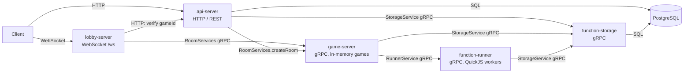

# Mahjong System

A Bun + TypeScript microservice platform for a plugin-driven Mahjong game. Game rules are extended through plugins that are stored in PostgreSQL, executed in a sandboxed runner, and hooked into the game loop by a stateful game server.

## Start here

- **Status:** the design is mostly written; the target architecture (4 services, sandboxed plugins in game-server, JetStream game log) is **not implemented yet**. The current code cannot finish a game. See [`modules/utils/docs/game-design-review.md`](modules/utils/docs/game-design-review.md) for what is broken.
- **AI agents:** read [`AGENTS.md`](AGENTS.md) first (`CLAUDE.md` imports it). It has the decision log, what is done and not done, local environment pitfalls, and the verification commands.
- **Humans, in order:** this README, then [`plugin-runtime-design.md`](modules/utils/docs/plugin-runtime-design.md) (target architecture), then [`kernel-concept.md`](modules/utils/docs/kernel-concept.md) (the generic core), then [`riichi-ruleset-roadmap.md`](modules/utils/docs/riichi-ruleset-roadmap.md) (the Riichi content).
- **Check your setup:**

  ```bash
  bun install
  bun run gen:proto                                  # needs protoc on PATH
  cd modules/game-server && bunx tsc --noEmit -p tsconfig.json
  helm lint helm/mahjong-system                      # needs helm
  ```

- **`spikes/` is git-ignored.** The benchmarks and `spikes/kernel-bench/RESULTS.md` exist only on the machine where they were run, so links to them do not resolve on a fresh clone.

## Architecture



- **Persistence lives in `api-server` and `function-storage` only.** `game-server` has no database; live game state is held in memory.
- **Services talk gRPC** using the definitions in `modules/proto/src/proto/services/*.proto`. Players connect through `lobby-server` (WebSocket); operators and the dashboard use `api-server` (HTTP).
- Detailed design notes are in [`modules/utils/docs/`](modules/utils/docs/) (architecture, game flow) and [`modules/function-storage/db/ER-diagram.md`](modules/function-storage/db/ER-diagram.md) (database).

### Target architecture (planned)

The diagram above is the current code. The plan reduces it to four services:

- **lobby-server:** Edge / BFF (static resources, login, game tickets). It no longer relays in-game traffic.
- **api-server:** Rooms, matchmaking and game allocation. It also subscribes to game events (spectating, achievements, game records).
- **game-server:** Runs games and plugins. Plugins run in K game Workers, each with one QuickJS runtime per game.
- **function-storage:** Stores plugins and RuleSets, and type-checks, builds and tests plugins on upload.

function-runner is removed. NATS JetStream holds the game log (written before each input is applied) and the event stream. See [`plugin-runtime-design.md`](modules/utils/docs/plugin-runtime-design.md) and [`flow-and-architecture-plan.md`](modules/utils/docs/flow-and-architecture-plan.md).

## Modules

| Module | Role | Listens on | Notes |
| :--- | :--- | :--- | :--- |
| [`api-server`](modules/api-server) | JSON REST API: room, game, player and plugin management (no HTML pages) | HTTP `PORT` | Runs DB migrations on startup |
| [`lobby-server`](modules/lobby-server) | Client gateway, WebSocket `/ws?playerId=` | HTTP/WS `PORT` | Verifies game through `API_URL` before connecting |
| [`game-server`](modules/game-server) | Game loop: `Game` → `Round` → `Table` / `Player`, plugin hooks | gRPC `GRPC_PORT` | No DB; game instances live in memory |
| [`function-storage`](modules/function-storage) | Stores plugin code, versions, dependencies and plugin definitions | gRPC `PORT` | Drizzle schema `function_storage` |
| [`function-runner`](modules/function-runner) | Runs plugin code in QuickJS worker pool; live modules | gRPC `PORT` | Fetches code from function-storage |
| [`plugins`](modules/plugins) | Built-in rule plugins (e.g. Furiten) | — | Compiled into the services that load them |
| [`proto`](modules/proto) | gRPC/protobuf contracts and generated TypeScript | — | Generated code is not committed |
| [`utils`](modules/utils) | Shared config, types, plugin interfaces, websocket helpers | — | Source of the env var defaults |

### Port and hostname contract

Clients always dial `<HOSTNAME>:GRPC_PORT`, while servers bind their gRPC listener to `PORT`. For a gRPC service to be reachable, its `PORT` must equal the `GRPC_PORT` its callers use.

| Variable | Default | Used by |
| :--- | :--- | :--- |
| `PORT` | `3000` | Server listen port (HTTP for api/lobby; gRPC for function-storage and function-runner) |
| `GRPC_PORT` | `4001` | game-server listen port; port that every gRPC client dials |
| `BIND_HOST` | `0.0.0.0` in Kubernetes, else `HOSTNAME`/`localhost` | Bind address |
| `STORAGE_HOSTNAME` | `storage-service` | Host for function-storage |
| `PLUGIN_RUNNER_HOSTNAME` | `plugin-runner-service` | Host for function-runner |
| `GAME_SERVER_HOSTNAME` | `game-server-service` | Host for game-server |
| `DATABASE_URL` | — | PostgreSQL for api-server and function-storage |
| `API_URL` | `http://localhost:30000` | lobby-server → api-server |

Module-specific variables (runner pool size, timeouts, etc.) are listed in each module's README.

## Prerequisites

- [Bun](https://bun.com) (used for install, scripts and builds)
- `protoc` (only needed to regenerate proto code; see [`modules/proto`](modules/proto))
- PostgreSQL for local runs (the Helm chart uses PostgreSQL 18)
- Optional for Kubernetes: Docker, [kind](https://kind.sigs.k8s.io), kubectl, Helm 3

## Local development

```bash
bun install            # from the repository root (Bun workspaces)
bun run gen:proto      # regenerate TypeScript from the .proto files (needs protoc on PATH)
```

Run a module from its folder, for example:

```bash
cd modules/function-storage
bun run migrate        # apply Drizzle migrations (needs DATABASE_URL)
bun run index.ts       # starts the gRPC server on PORT
```

Start the remaining services with `bun run index.ts` in their folders, with `PORT`/`GRPC_PORT` set so the port contract above holds.

## Kubernetes (Helm + kind)

```bash
bun run cluster:create                                    # kind cluster with NodePorts 30000/30001
helm install mahjong ./helm/mahjong-system -f helm/mahjong-system/values-dev.yaml
bun run cluster:delete                                    # tear down the kind cluster
```

See [`helm/mahjong-system/README.md`](helm/mahjong-system/README.md) for chart values and PostgreSQL initialization.

## CI

[`.github/workflows/ci-build.yml`](.github/workflows/ci-build.yml) builds the images for `api-server`, `game-server`, `lobby-server`, `function-runner` and `function-storage` from each module's `Dockerfile` and pushes them to GHCR on pushes to `main`/`master`. Each Dockerfile runs `bun run gen:proto`, so the build depends on `protoc` and the proto generation script working on Linux.

## Documentation

| Document | Contents |
| :--- | :--- |
| [`modules/utils/docs/architecture-extensibility.md`](modules/utils/docs/architecture-extensibility.md) | Extensibility decisions for plugins and the runner |
| [`modules/utils/docs/riichi-ruleset-roadmap.md`](modules/utils/docs/riichi-ruleset-roadmap.md) | Direction and roadmap for a full Japanese Riichi ruleset on the plugin system |
| [`modules/utils/docs/game-flow.md`](modules/utils/docs/game-flow.md) | Lobby / Game / Round state machines and the current implementation |
| [`modules/utils/docs/game-design-review.md`](modules/utils/docs/game-design-review.md) | Game design review: blocking bugs, plugin conflict handling, RuleSet direction (with diagrams) |
| [`modules/utils/docs/flow-and-architecture-plan.md`](modules/utils/docs/flow-and-architecture-plan.md) | Architecture assessment (service split, complexity, extensibility, language) and the redesigned full Riichi flow |
| [`modules/utils/docs/kernel-concept.md`](modules/utils/docs/kernel-concept.md) | Generic kernel concept for L5 extensibility (pieces, zones, phases, windows, effects, builtins) |
| [`modules/utils/docs/plugin-runtime-design.md`](modules/utils/docs/plugin-runtime-design.md) | Plugin runtime and the 4-service target: game Worker shards with QuickJS sandboxes, fault isolation, upload validation in function-storage, JetStream game log |
| [`spikes/kernel-bench/RESULTS.md`](spikes/kernel-bench/RESULTS.md) | Benchmark: Go + Starlark vs TypeScript + QuickJS for the kernel hot path |
| [`modules/game-server/src/classes/api_docs.md`](modules/game-server/src/classes/api_docs.md) | Plugin developer manual (hooks, patches, storage) |
| [`modules/function-storage/db/ER-diagram.md`](modules/function-storage/db/ER-diagram.md) | `function_storage` database schema |
| [`helm/mahjong-system/README.md`](helm/mahjong-system/README.md) | Helm chart usage |
| [`todo/docs/`](todo/docs) | Backend and frontend implementation plans |
