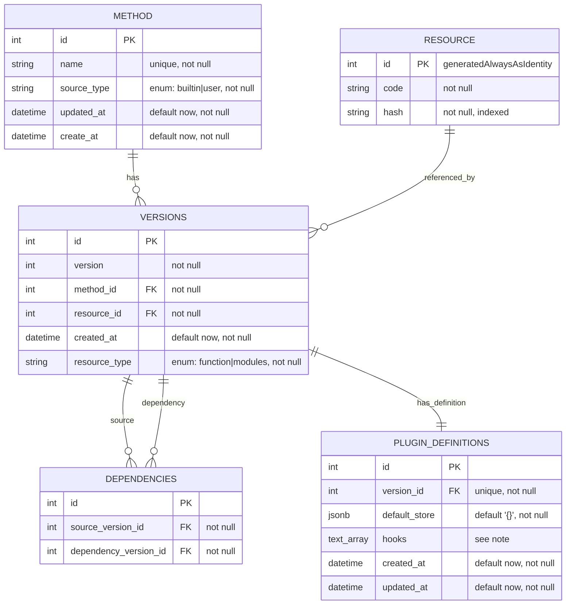

# Function Storage — ER Diagram

:::info
this doc is generated by AI, then checked against `db/schema.ts` and `db/migrations/0000_massive_franklin_storm.sql`
:::

This file contains an English ER diagram for the `function_storage` schema (`db/schema.ts`).

Notes:

- `versions` links to `method` and `resource` through foreign keys.
- `versions` is unique on `(method_id, version)`. The index is named `uq_versions_method_version_type`, but it does not include `resource_type`.
- `dependencies` is a pair of version references, unique on `(source_version_id, dependency_version_id)`. The schema has no version constraint column.
- `resource.hash` is indexed but not unique, so identical code can be stored more than once.
- `plugin_definitions` is one-to-one with `versions` (unique `version_id`).
- `plugin_definitions.default_store` is `jsonb` (default `'{}'`). It was changed from a JSON string in commit `443edaf`.
- `plugin_definitions.hooks` is a `text[]`, `NOT NULL`. Migration `0001_soft_wallow.sql` adds the constraint; `0000` created the column nullable.
