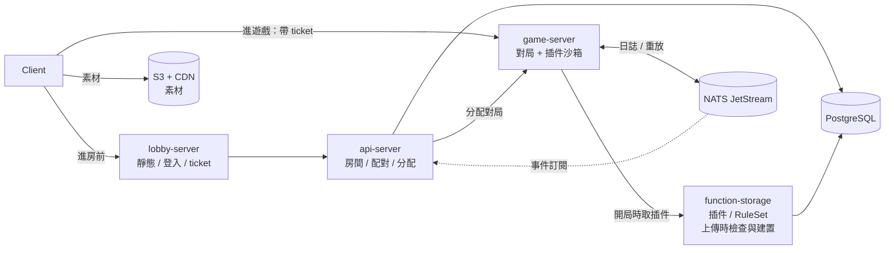
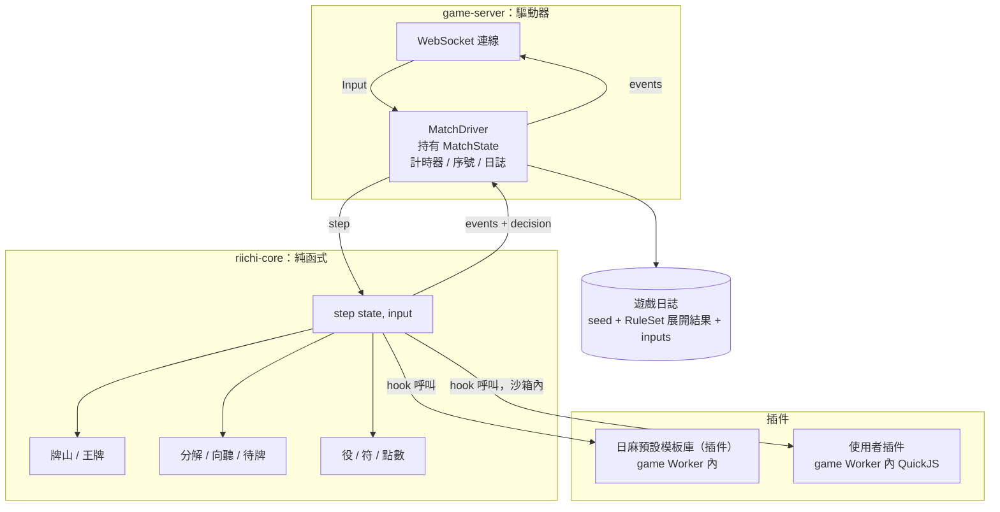
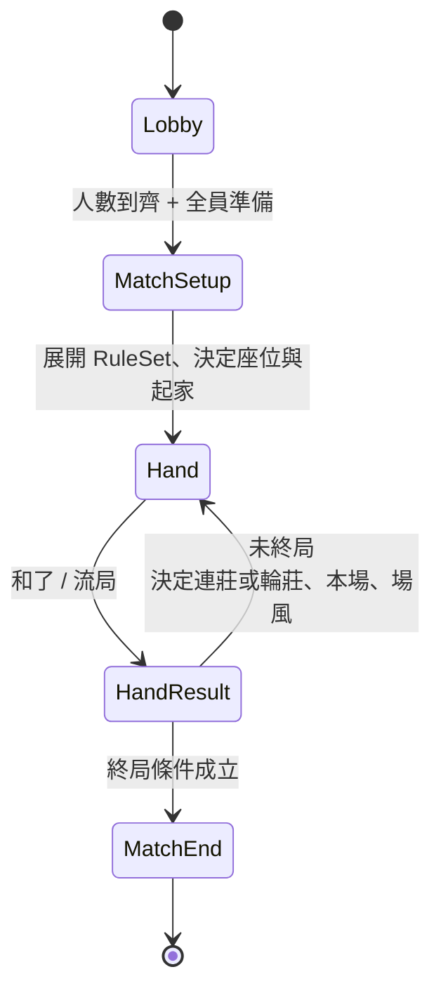
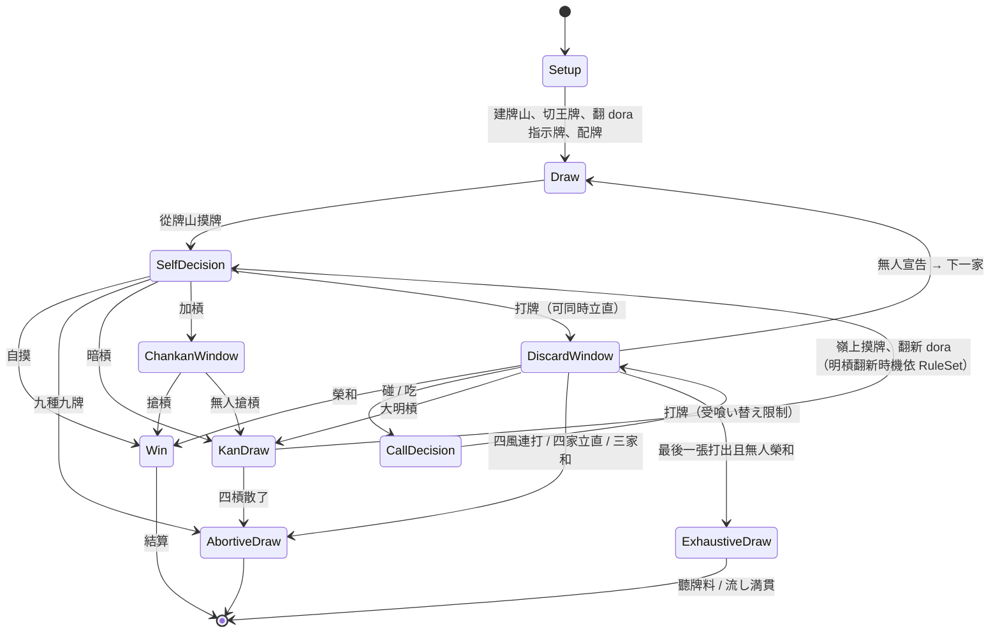
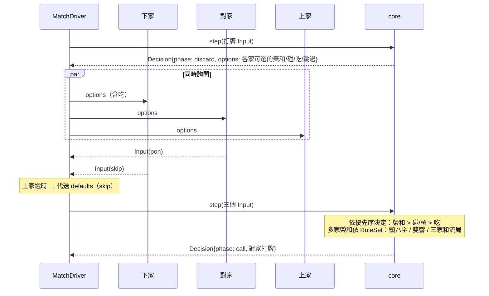

# 完整流程重新規劃與架構評估

> 2026-11-05。這份文件包含兩部分：A. 架構評估（拆分、複雜度、可擴展性、語言）；B. 完整的日麻流程重新規劃。
> 前置文件：[game-design-review.md](game-design-review.md)（目前實作的問題）、[riichi-ruleset-roadmap.md](riichi-ruleset-roadmap.md)（規則模組的方向）。

---

# A. 架構評估

## A1. 數據

| 模組 | 手寫行數 | 角色 |
| :--- | ---: | :--- |
| game-server | 3440 | 流程、插件管線 |
| api-server | 2503 | REST、dashboard（含大量 HTML） |
| function-runner | 2403 | QuickJS 沙箱、worker pool、live module |
| utils | 1023 | 共用型別 |
| function-storage | 1002 | 程式碼版本儲存 |
| lobby-server | 319 | WebSocket 轉發 |
| **plugins（真正的麻將規則）** | **222** | 振聽、工具函式 |

- 手寫 TypeScript 約 11k 行，另有 6.3k 行 proto 生成碼。
- **測試：0 個。**
- 基礎設施對規則的比例約 50 : 1。

## A2. 服務拆分：4 個服務

> 更新（2026-11-06）：function-runner 移除。插件執行併入 game-server，上傳時的 TS / JS 檢查與建置併入 function-storage。對局日誌與事件改用 NATS JetStream。詳見 [plugin-runtime-design.md](plugin-runtime-design.md)。

| 服務 | 職責 | 和目前程式的差距 |
| :--- | :--- | :--- |
| lobby-server | Edge / BFF：靜態資源、登入、發 ticket、房間外的事件；房間外的守門員 | 目前沒有靜態資源與 auth，反而在**遊戲熱路徑上**轉發每個動作 |
| api-server | lobby 背後的處理端：房間、配對、對局分配、持久化；訂閱對局事件（觀戰、成就、牌譜） | 大致符合；訂閱事件是新增 |
| game-server | 對局：WS / RTC ingress；K 個 game Worker，每個負責一批對局並在 QuickJS 沙箱執行插件 | 需要自行驗證 ticket、接受客戶端連線；接手 function-runner 的執行功能 |
| function-storage | 插件與 RuleSet 的 registry（版本、依賴）；上傳時的型別檢查、建置與測試 | 儲存部分符合；檢查管線是新增（接手 function-runner 的驗證功能） |
| ~~function-runner~~ | 移除 | 執行併入 game-server，驗證併入 function-storage |

| 基礎設施 | 用途 |
| :--- | :--- |
| PostgreSQL | api-server 與 function-storage 的資料 |
| NATS JetStream | 對局日誌（先寫再套用）、每局快照、事件扇出；開發與小規模可單節點 |
| S3 + CDN | 圖片、牌面等素材 |



**三個關鍵：**

- **game-server 自行驗證 ticket**（例如簽章過的 JWT），不要回頭呼叫 lobby。這樣進行中的對局不依賴 lobby。
- **lobby 不再轉發遊戲訊息。** 目前 lobby 到 game-server 的 gRPC bidi stream 會移除；對局中的流量直接進 game-server。
- **沙箱出錯不拖垮 game-server。** 主執行緒不執行插件；錯誤被限制在單次呼叫、單局或單一 Worker，並靠 JetStream 日誌復原（plugin-runtime-design.md 第 4 節）。

**原則：** 不再增加新的服務。模組化優先放在程式碼邊界（核心與內容），不放在網路邊界。

## A3. 複雜度：確實太高，但大部分是附帶複雜度

**必要複雜度**（不可避免）：日麻規則本身、使用者程式碼沙箱。

**附帶複雜度**（可以移除）：

| 來源 | 現況 | 收斂方式 |
| :--- | :--- | :--- |
| 一次玩家動作經過 4 個行程 | Client → lobby → game-server → runner → worker → QuickJS | lobby 不再轉發遊戲訊息；所有規則（含使用者插件）在 game-server 行程內執行 |
| 插件執行順序的啟發式排序 | `getHookPipeline` 約 200 行，依全域變數的修改次數排序 | 由 RuleSet 展開時決定順序，執行期只照順序跑 |
| 兩條插件執行路徑語意不同 | 本地插件會套用 `storagePatch`，runner 插件會被丟掉 | 統一成一條路徑：插件只回傳結果，由驅動器套用 |
| 三種動作格式 | 數字、`PlayerAction` enum、`PluginActionDefinition` | 只保留 `PluginActionDefinition` |
| 四組訊息 enum 加上對照表 | `GameMessageEnum`、proto `Event`、`PlayerMessageEnum`、`RoomMessageEnum` | 一組事件型別，proto 只帶 `type` 字串與 payload |
| 狀態分散在 6 個地方 | `Game.players`、`Table`、`Round`、`Player`、`PluginManager` storage、runner 的 `__state__` | 單一 `MatchState`，由純函式 reducer 產生 |
| live module（有狀態的 VM） | 插件狀態同時存在 game-server 與 runner | runner 改為無狀態：狀態隨呼叫傳入、隨結果傳出 |

收斂後的效果：每一次狀態變更都可以用 `state' = step(state, input)` 描述，這同時解決重放、快照與測試的問題。

## A4. 可擴展性目前到哪裡

| 層級 | 內容 | 例子 | 設計上 | 實際可用 |
| :--- | :--- | :--- | :--- | :--- |
| L0 | 參數 | 起始點數、赤牌數、局數 | 無（沒有 RuleSet / config） | ✗ |
| L1 | 加法規則 | 新役、點數加成 | ✓（`onEvaluateHand`、`onCalculateScore`） | ✗（`calcScore` 未接線） |
| L2 | 否決 | 振聽、禁止某動作 | ✓（`onValidateAction`） | ✗（`playerId` 沒傳，`ResolvingPlayerAction` 到不了） |
| L3 | 新動作 | 自訂技能按鈕 | ✓（`CUSTOM_PLUGIN`） | ✗（驗證只接受數字；回覆只接受固定 enum） |
| L4 | 新階段 / 流程 | 換三張、血戰到底 | ✗ | ✗ |
| L5 | 新牌 / 人數 | 花牌、三人麻將 | ✗（牌型與四人假設寫死） | ✗ |

**結論：** 設計上大約到 L3，實際可用是 L0。完整的日麻需要 L0–L2；你說的「高自由度」通常指 L3，有時是 L4。

B 部分的流程設計讓 L0–L3 全部可用，並替 L4 留下明確的擴充點（階段由 RuleSet 宣告），但第一版不實作 L4 與 L5。

## A5. 語言：維持 TypeScript，規則執行搬進行程內

> 決定（2026-11-06 更新，依 spike 數據）：維持 TypeScript。所有規則都是插件（日麻基本規則是預設模板庫），在 game-server 的 game Worker 內以 QuickJS 執行：每個 Worker 負責一批對局，每局一個 runtime，每一局重建 context。設計見 [plugin-runtime-design.md](plugin-runtime-design.md)。
>
> - 原生核心 Go 只比 Bun JIT 快 1.2–1.3×；行程內對遠端 runner 則差 100× 以上。
> - 300 局同時運行：QuickJS 行程內約佔一個核心的 1.2%、沙箱記憶體約 40–85 MB。
> - Starlark 沒有型別、IDE 支援少；使用者對著有型別的 SDK 寫 TypeScript，上傳時可以先做型別檢查。
> - 單一 Pod 需要上萬局、或需要大量不等待的自我對弈時，再重新評估 Go + Starlark（沙箱快 2.5×、每局記憶體 KB 等級）。

以下是決定前的分析。

> 更新（2026-11-05）：原本的結論是「現在不要換」。在 L5 的前提下，核心本來就要重寫（`Round`、`Game` 都會被取代），所以重寫成本的論點變弱了；而且只需要重寫核心與 game-server，其他服務可以留在 TypeScript，用現有的 proto 溝通。

效能的來源依序是：

1. **規則在行程內執行**，不經過 runner 的跨行程呼叫。
2. **語言與執行方式**：原生（Go、JIT 的 JS）> 解譯器（Starlark、QuickJS）。
3. **資料轉換成本**：每次呼叫沙箱都要把狀態轉成沙箱內的值。

Go + Starlark 同時拿到 1 與 2 的一部分；TS + 行程內 QuickJS 拿到 1。實際差距由 spike 量測，結果見 `spikes/kernel-bench/RESULTS.md`。

---

# B. 完整流程重新規劃

> 更新（2026-11-05）：目標改為 L5 之後，B 部分描述的是**日麻 RuleSet 的階段圖**，不是核心程式碼。核心的通用元件見 [kernel-concept.md](kernel-concept.md)；本節的 Hand 狀態機、Decision、宣告視窗會用核心的 Phase、Decision、Window 表達。

## B1. 核心原則

1. **規則核心是純函式 reducer。** `step(state, input) → { state, events, decision }`，沒有 I/O、計時器或隨機數。
2. **驅動器（game-server）只做 I/O。** 它持有狀態、送出決策、收集回覆、處理逾時、記錄日誌。
3. **所有輸入走同一條路徑。** 玩家回覆、逾時預設動作、系統事件都是一個 `Input`。逾時就是驅動器代替玩家送出預設動作，所以不會再卡住（修正 B4）。
4. **狀態可以從日誌重建。** `MatchState = fold(step, initialState(seed, ruleSet), inputs)`。
5. **插件只回傳結果，不直接改狀態。** 由核心套用插件的結果，並檢查不變量。

## B2. 分層



`step` 需要插件結果時有兩種做法：讓 `step` 回傳「需要呼叫 hook X」，由驅動器呼叫後再把結果當成輸入送回；或讓 `step` 接受一個注入的 hook 執行器。前者讓核心完全純粹，後者比較好寫。**決定：兩者都用後者（同步、行程內）。使用者插件在行程內的 QuickJS 同步執行（見 [plugin-runtime-design.md](plugin-runtime-design.md)），回傳值仍寫進日誌，用於重放時比對。**

## B3. 三層狀態機

### B3.1 Match 層（整場）



**終局條件（RuleSet 設定）：** 南 4 局結束；有人被擊飛（點數 < 0）；可選的西入；可選的和了止め。

**連莊條件：** 莊家和了，或流局時莊家聽牌。中途流局是否連莊由 RuleSet 決定。

### B3.2 Hand 層（一局）



### B3.3 決策點（Decision）

每一個需要玩家回應的狀態（`SelfDecision`、`DiscardWindow`、`ChankanWindow`、`CallDecision`）都產生一個 `Decision`：

```typescript
type Decision = {
  seq: number;                          // 單調遞增，取代 requestId
  phase: 'self' | 'discard' | 'chankan' | 'call';
  deadline: number;                     // 驅動器使用；核心不讀時間
  options: Record<PlayerId, PluginActionDefinition[]>;  // 每位玩家可選的動作
  defaults: Record<PlayerId, ActionChoice>;             // 逾時時的預設動作
};

type Input = {
  seq: number;                          // 必須等於目前 Decision 的 seq
  playerId: PlayerId;
  actionId: string;                     // 'discard' | 'riichi' | 'tsumo' | 'pon' | ... | 自訂 id
  payload?: unknown;                    // 例如 { tileId: 57 }
};
```

- 舊的 `seq` 直接拒絕，取代目前沒有作用的 `requestId`。
- `options` 由核心產生標準動作，再經過 `onEvaluateAvailableActions` 讓插件增加或移除，所以 `CUSTOM_PLUGIN` 動作可以從頭到尾走通（L3）。

### B3.4 宣告視窗的處理



**優化：** 如果某家回覆了最高優先序的動作（例如榮和），且不可能被其他回覆蓋過，可以提早結算，不必等所有人回覆。這也由核心判斷。

## B4. 插件 hook 對應到流程

| Hook | 呼叫時機 | 模式 | 典型用途 |
| :--- | :--- | :--- | :--- |
| `provideWall`（新增） | `Setup` | Query | 自訂牌山（赤牌、花牌）；預設由 seed 產生 |
| `onHandStart` | `Setup` 之後 | Command | 重設每局狀態 |
| `onEvaluateAvailableActions` | 每個 Decision 產生時，**對每位玩家各呼叫一次** | Query | 增減可選動作 |
| `onValidateAction` | 收到 Input 時 | Query | 否決（振聽、立直後不能換牌） |
| `onResolveAction` | Input 被採用後 | Command | 更新插件狀態 |
| `onEvaluateHand` | `Win` | Query | 回報役（以役 id 回報） |
| `onCalculateScore` | `Win`、`ExhaustiveDraw` | Query | 修改番、符、點數 |
| `onScoreDistribution` | 結算 | Query | 修改支付方式 |
| `onHandEnd` / `onMatchEnd` | 結束時 | Command | 統計、成就 |

**規則：**

- `Query` 只能回傳資料（動作清單、役、點數），**不能**回傳 patch。驅動器會強制這一點。
- `Command` 可以回傳插件自己的 storage patch。
- 會改變遊戲狀態的唯一途徑是核心套用 `Input`。插件不能直接修改手牌或點數。
- 結算後檢查點數守恆，違反時拒絕插件結果並記錄錯誤。

## B5. 牌山的提供（修正 B1）

採用上一則的建議：**每局開始時由「牌山提供者」產生新牌山。**

1. 預設提供者：`buildWall(seed, ruleSet.config)`，產生 136 張實體牌（id 0–135），依設定標記赤牌。
2. RuleSet 可以指定一個 `provideWall` 插件取代預設提供者（只能有一個，展開時檢查）。
3. 測試與重放時，可以由外部直接注入牌山。這就是目前 `setTable()` 的用途，改成在 `Setup` 使用，`GAME_START` 不再清空。
4. 每局的 `seed` 由整場的 `seed` 與局號推導出來，所以只需要記錄一個 `seed`。

## B6. 狀態型別（初版）

```typescript
type MatchState = {
  ruleSet: ResolvedRuleSet;             // 展開結果（插件、順序、config）
  seed: string;
  seats: [PlayerId, PlayerId, PlayerId, PlayerId];  // 固定，不再每局洗
  scores: Record<PlayerId, number>;
  roundWind: Wind;
  dealerSeat: 0 | 1 | 2 | 3;
  honba: number;
  riichiSticks: number;
  hand: HandState | null;
  pluginState: Record<PluginId, unknown>;
  decision: Decision | null;
};

type HandState = {
  wall: TileId[];
  deadWall: { rinshan: TileId[]; doraIndicators: TileId[]; uraIndicators: TileId[]; revealed: number };
  players: Record<PlayerId, {
    concealed: TileId[];
    melds: Meld[];
    discards: { tile: TileId; called: boolean; riichi: boolean }[];
    riichi: null | { turn: number; double: boolean; ippatsu: boolean };
    furiten: { permanent: boolean; temporary: boolean };
  }>;
  turn: { seat: number; drawn: TileId | null; source: 'wall' | 'rinshan' | null };
  flags: { firstGoAround: boolean; kanCount: Record<PlayerId, number> };
};
```

## B7. 從現有程式遷移

| 現有 | 遷移後 |
| :--- | :--- |
| `Round` | 拆成 `riichi-core` 的 `step`（規則）與 `MatchDriver`（計時、I/O） |
| `Game` | `MatchDriver`；`players`、`table` 改成 `MatchState` 的一部分 |
| `Table`、`Player`、`Tile` | 移入 `riichi-core`，改用實體牌 id |
| `PluginManager` | 保留 hook 執行；移除啟發式排序，改用 RuleSet 展開的順序；移除兩條路徑的差異 |
| `requestId` | `Decision.seq` |
| `GameMessageEnum` 等四組 enum | 一組 `GameEvent` 型別；proto 只帶 `type` 與 payload |
| lobby-server | 保留為 Edge / BFF；移除遊戲訊息的轉發（見 A2） |
| function-storage | 保留為插件與 RuleSet 的 registry，並接手上傳時的檢查與建置 |
| function-runner | 移除：執行併入 game-server，驗證併入 function-storage |

## B8. 實作順序

每一步都有可以驗證的結果：

1. **`riichi-core` 的牌與牌山。** 實體牌 id、seed 牌山、王牌。驗證：每種牌 4 張、赤牌數量正確、同一 seed 結果相同。
2. **手牌分析。** 分解、向聽、待牌、振聽。驗證：fixture 測試。
3. **`step` 的 Hand 層流程，不含計分。** 所有狀態轉換、宣告優先序、槓與嶺上、流局。驗證：固定 seed 與輸入序列的 golden test。
4. **`MatchDriver`。** 接到 game-server，取代 `Round` 與 `Game`。驗證：四個測試客戶端能打完一局（以流局結束）。
5. **計分。** 役、符、點數、支付。驗證：fixture 加外部計算器比對。
6. **Match 層。** 連莊、本場、場風、終局。驗證：整場 golden test。
7. **RuleSet 展開器與插件 hook。** 驗證：用一個 house rule（例如無喰い断）切換結果。
8. **服務職責修正。** lobby 改為 Edge / BFF、移除遊戲訊息轉發；game-server 自行驗證 ticket；Agones 一局一個 Pod。
9. **使用者插件。** 行程內 QuickJS（每局一個 runtime）與上傳驗證管線，見 [plugin-runtime-design.md](plugin-runtime-design.md)。驗證：300 局的記憶體與 CPU 測試、重放一致。

步驟 1–3 完全不碰網路與服務，可以先用 `bun test` 開發；這也是目前 0 測試的情況下最需要補的部分。
