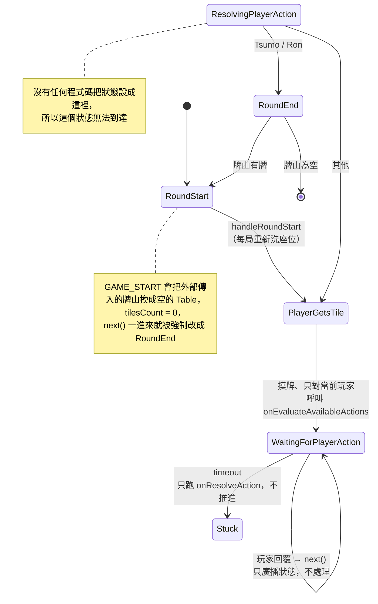
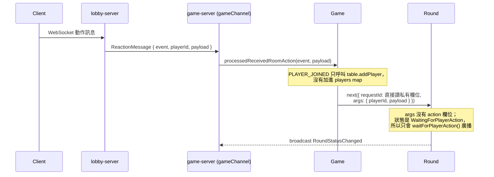
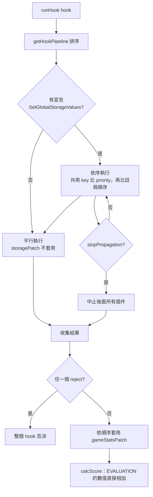
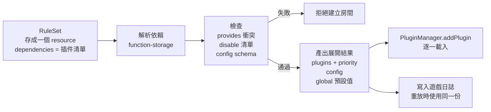

# Game 設計檢查

> 檢查日期：2026-11-05。範圍：`game-server/src/classes/`（`game.ts`、`round.ts`、`table.ts`、`player.ts`）、`game-server/src/plugins/plugin-manager.ts`、`utils/src/interfaces/plugin.ts`、`utils/src/mahjong/type.ts`、`plugins/src/system/furtin.ts`。只讀程式碼，未修改。

## 0. 結論

- **設計方向是對的**：「固定外框 + 可擴充內容」的動作格式、hook 管線、patch 機制，都適合用來實作日麻。
- **實作目前跑不完一局**：原因是幾處接線還沒完成（第 2 節），不是設計錯誤。包括外部傳入的牌山在開局時被清掉、玩家沒進入 `players`、玩家回覆永遠不會被處理。
- 對上一則回答的六點，修正後的判斷見第 4 節。

## 1. 目前實際的流程

### 1.1 回合狀態機（實際行為）

### 1.2 玩家動作的訊息路徑

## 2. 部分實作的接線缺口（跑不完一局）

這幾項的設計意圖都存在，只是接線還沒完成。

| # | 問題 | 位置 | 結果 |
| :--- | :--- | :--- | :--- |
| B1 | 牌山設計上由外部傳入（`Game.setTable()`），但 `GAME_START` 呼叫 `createNewRound({ resetTable: true })` 會換成空的 `Table`，覆蓋掉注入的牌山。每手結束回到 `RoundStart` 時也沒有換新牌山的入口；`onGameStart` 沒有被呼叫，`gameStatsPatch` 也沒有牌山類型的 patch | `game.ts:149`、`game.ts:355`、`round.ts:467` | 開局時牌山是空的，`next()` 直接進 `RoundEnd` |
| B2 | 玩家沒進入 `Game.players`：`PLAYER_JOINED` 只呼叫 `table.addPlayer`，`Game.addPlayer` 沒有呼叫點 | `game.ts:366` | `GAME_START` 時 `handleRoundStart` 丟出 `Cannot start round with zero players` |
| B3 | `ResolvingPlayerAction` 無法到達：沒有任何地方設定這個狀態；而且 `processedReceivedRoomAction` 傳的 `args` 沒有 `action` | `round.ts:520`、`game.ts:392` | 玩家回覆永遠不會被處理 |
| B4 | 逾時只跑 `onResolveAction`，不改狀態、不呼叫 `next()` | `round.ts:187` | 逾時後遊戲停住 |
| B5 | `calcScore()` 沒有呼叫點 | `round.ts:687` | `onEvaluateHand`、`onCalculateScore` 永遠不會執行，不會結算 |

## 3. 邏輯 bug

接線完成之後仍然會出錯的地方。

| 問題 | 位置 | 結果 |
| :--- | :--- | :--- |
| `playerActionNumToEnum` 的陣列順序是 `[..., Ron, Riichi, Tsumo]`，但 `PlayerAction` 是 `Ron=4, Tsumo=5, Riichi=6` | `round.ts:263` | 插件回報 `Tsumo` 會變成 `Riichi`，反之亦然 |
| `onEvaluateAvailableActions` 只在摸牌後對當前玩家呼叫 | `round.ts:284` | 打牌後沒有詢問其他三家，吃、碰、明槓、榮和不會出現 |
| 同時宣告沒有優先序；`actingPlayerId` 取 `Map` 迭代的最後一個 | `round.ts:363` | 碰與吃同時宣告時，結果取決於回覆順序 |
| `handleRoundStart` 每局重新洗座位；`currentWind` 每局 +1 | `round.ts:128`、`454` | 座位與場風不符合日麻（座位固定、莊家輪轉、場風一圈才換） |
| `next()` 在 `finally` 中輪換 `requestId`，但 `return` 的值在輪換前取得 | `round.ts:554–558` | 回給呼叫者的 `requestId` 立刻失效；`Game` 又直接讀私有 `currentRequestId` 繞過檢查，所以保護沒有作用 |
| hook context 的 `playerId` 沒有傳（只在 `payload` 裡） | `round.ts:288`、`plugin-manager.ts:418` | `furtin.ts` 檢查 `context.playerId` 後直接返回，振聽從未生效 |
| `doraIndicators` 用的是 `getRedDoraTiles()`；`isRiichi` 永遠是 `false`；`isFirstTurn` 用 `roundIndex === 0` | `round.ts:592` | 傳給計分插件的資料不正確 |
| runner 插件的 `implementation` 是空的，被判定為可平行執行，平行分支用 `mutateStorage = false` | `plugin-manager.ts:366`、`513` | runner 插件回傳的 `storagePatch` 會被丟棄 |

## 4. 對六點的修正判斷

### 4.1 Event / Action：同意，設計上是「固定外框 + 可擴充內容」

`PluginActionDefinition { id, label, type: STANDARD | CUSTOM_PLUGIN | EVALUATION, payload }`，加上 proto 的 `Struct payload`，就是你說的做法。我上一則說「封閉」不準確。

問題在**實作把它收窄了**：

- `Round.runHook` 用 `pluginAction: z.array(z.number())` 驗證結果，`CUSTOM_PLUGIN` 物件會讓整筆結果（包括同一筆裡的 `reject`）被丟掉。
- 玩家回覆只接受 `PlayerActionType`（`z.enum(PlayerAction)`）。
- `calcScore` 卻是用物件形式的 `EVALUATION`，所以兩種格式並存。

**方向**：全部統一成 `PluginActionDefinition`。`STANDARD` 的 `id` 對應 `PlayerAction`，玩家回覆改為 `{ actionId, payload }`。

### 4.2 流程：部分同意，日麻不需要開放流程

動作檢測（`onEvaluateAvailableActions` → `onValidateAction` → `onResolveAction`）解決的是：**哪些動作可用、是否合法、做完的副作用**。

沒有解決的是：**做完之後輪到誰、進入哪個階段**，這寫在 `handleResolvingPlayerAction` 的 `switch`。

對日麻來說這不必開放給插件，因為日麻的流程是固定的。需要的是核心流程**完整**：

- 打牌後對其他三家開宣告視窗
- 宣告優先序（榮和 > 碰、槓 > 吃）
- 槓 → 嶺上 → 翻新 dora
- 加槓時的搶槓視窗

只有非日麻的變體（例如換三張、血戰到底）才需要可插拔的流程。所以這點從「設計問題」改為「核心流程未完成」。

### 4.3 衝突處理：目前的機制

在日麻裡會出問題的情況：

| 情況 | 現況 |
| :--- | :--- |
| 兩個插件都回報同一個役（例如平和） | 番數直接相加，重複計算；沒有以役 id 去重 |
| 出現役滿時，普通役應該被捨棄 | 沒有機制 |
| house rule 想關掉某個役（例如無喰い断） | 只能 `stopPropagation`（會連帶中止後面所有插件）或 `reject`（否決整個 hook） |
| 兩個插件寫同一個全域 key | 初始化時比 priority，執行期是最後寫入者勝出 |
| `mode: Query` 的 hook 回傳 `gameStatsPatch` | 仍然會被套用；`Query` / `Command` 只有宣告，沒有強制 |

**方向**：

- 役以 id 為鍵，插件宣告 `provides: ['pinfu']`。同一個 id 只能有一個提供者，在 RuleSet 展開時檢查。
- 互斥群組：役滿群組出現時覆蓋普通役群組。
- 關閉某個役放在 RuleSet 的 `disable` 清單，展開時就移除，不需要在執行期處理。
- 強制 `Query` hook 不能回傳 patch。

### 4.4 `calcScore` 無呼叫點：同意是 bug

列為 B5。

### 4.5 牌的模型：概念有，但沒有接上

- `RedDora<T>`（`isRedDora`）型別存在，但沒有任何地方使用。
- `MahjongTile` 本身沒有 `isRed`。所有相等判斷都只比 `type + index`，所以 `removeHandTile(5m)` 會移除第一張 5m，紅色資訊在手牌操作中會遺失。
- `Table.redDoraTile` 是「哪一種牌是紅的」的清單，不是實體牌。
- 沒有王牌、嶺上牌、dora 指示牌的結構；`addUraDoraTile` 也沒有呼叫點。

**方向**：每張實體牌給一個 id（0–135），用 id 判斷「同一張」，用 `type + index` 判斷「同一種」。赤牌由牌山設定決定哪些 id 是紅的。

### 4.6 RuleSet 作為後處理：同意，這比我上一則的設計更好

RuleSet 在載入時展開成一整組插件與設定，執行期的 `PluginManager` 完全不用改。這也能直接沿用 function-storage 已有的 `versions` 與 `dependencies`。

重點：

- 衝突在**建立房間時**就被擋下，不會在對局中途才發現。
- 展開結果要寫進遊戲日誌，重放時才會用同一組插件與版本。

## 5. 建議順序

1. **讓一局能跑完**：修 B1–B4，以及 Tsumo / Riichi 對調。
2. **完成日麻核心流程**：打牌後的宣告視窗、宣告優先序、槓與嶺上、座位與場風。
3. **統一動作格式**：全部改用 `PluginActionDefinition`，並傳入 hook context 的 `playerId`。
4. **計分**：接上 `calcScore`，加入役 id 去重與役滿覆蓋。
5. **牌的 identity**：實體牌 id、王牌與 dora 指示牌。
6. **RuleSet 展開器**：依第 4.6 節的流程。
