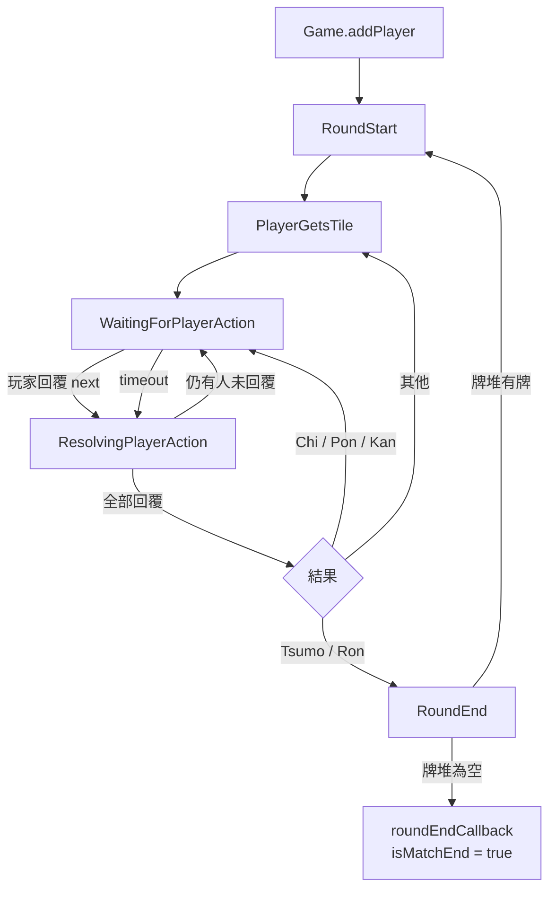

# 遊戲完整流程執行文檔

此文件描述目前 `modules/game-server/src/classes/` 中的遊戲執行流程（`game.ts`、`round.ts`、`table.ts`、`player.ts`），以及 `modules/utils/src/mahjong/type.ts` 中的狀態列舉。內容以目前程式碼為準，尚未實作的部分會明確標示。

> 最後核對：2026-11-05

## 1. 核心資料與責任

### 1.1 `Game`（`game-server/src/classes/game.ts`）
`Game` 是單一對局的外層物件，負責：
- 管理玩家加入與移除（`addPlayer` / `removePlayer`）
- 持有 `Table` 與目前的 `Round`，並把 `next()` 轉交給 `Round`
- 在回合結束時透過 `roundEndCallback` 通知外層

### 1.2 `Round`（`game-server/src/classes/round.ts`）
`Round` 是實際的回合狀態機，負責：
- 推進 `roundStatus`（見第 2.3 節），所有 `handle*` 方法都在這裡
- 維護 `requestId`，避免舊請求覆蓋新狀態
- 管理 timeout 與玩家回覆（`pendingPlayerActions`、`resolvedPlayerActions`）
- 透過 `PluginManager` 執行 hook（`runHook`）

### 1.3 `Table`（`game-server/src/classes/table.ts`）
桌面層資料：
- 牌堆 `tiles`
- 玩家摸到但尚未處理的牌 `playersDrawedTiles`
- 玩家已使用牌 `playersUsedTiles`
- 玩家操作紀錄 `playersActionTiles`
- 紅寶牌與裏寶牌

### 1.4 `Player`（`game-server/src/classes/player.ts`）
單一玩家的手牌與個人狀態：`handTiles`、`usedTiles`，以及抽牌、棄牌、移除手牌等操作。

### 1.5 `requestId`
`Round.next()` 結束時會輪換 `currentRequestId`（`finally` 區塊）。這代表：
- 任何外部回呼都必須帶正確的 `requestId`，否則丟出 `Invalid request ID`
- 舊的回呼會被拒絕，避免非同步或延遲回覆污染新一輪狀態

## 2. 狀態列舉

定義於 `modules/utils/src/mahjong/type.ts`。

### 2.1 Lobby 狀態：`MahjongGameLobbyStatus`
- `WaitingForPlayers`、`GameInProgress`、`GameEnded`
- **目前程式未使用**，僅為最外層生命週期的預留定義。

### 2.2 Game 狀態：`MahjongGameStatus`
- `Idling`、`StartGame`、`StartRound`、`RoundSettlement`、`RoundEnd`、`GameEnd`
- **目前程式未使用**，`Game` 類別沒有對應欄位。

### 2.3 Round 狀態：`MahjongGameRoundStatus`
- `RoundStart`：回合初始化
- `PlayerGetsTile`：當前玩家摸牌
- `WaitingForPlayerAction`：等待玩家反應（外部事件推進）
- `ResolvingPlayerAction`：處理玩家回覆
- `RoundEnd`：回合結束

這是目前真正在用的狀態機。

## 3. 完整執行流程

## 4. 目前實作中的實際流程

> ⚠️ 以下描述的是程式的**設計意圖**。實際上目前跑不完一局（接線未完成）：外部傳入的牌山在開局時被清掉、玩家沒進入 `players`、`ResolvingPlayerAction` 無法到達、逾時後會停住。詳見 [game-design-review.md](game-design-review.md) 第 2 節。

### 4.1 加入玩家
`Game.addPlayer(playerId)`：
- 玩家重複會拋出 `Player already exists`
- 只能在 `RoundStart` 狀態下加入，否則拋出 `Cannot add player after round started`
- 同步加入 `Table`

### 4.2 開始回合
`Round.handleRoundStart()`：
- 將玩家 ID 洗牌後建立本回合順序（`playerIdForTurnOrder`）
- 將 `currentPlayerIndex` 歸零
- 狀態改為 `PlayerGetsTile`，並在 `next()` 中接續處理

### 4.3 玩家摸牌
`Round.handlePlayerGetsTile()`：
- 牌堆為空時直接返回（流局規則尚未實作，見程式中的 TODO）
- 從牌堆取出索引 0 的牌，加入該玩家的摸牌紀錄
- 呼叫 `checkPlayerActionType()`，透過 `onEvaluateAvailableActions` 讓插件回傳可用動作
- 目前只有 `Tsumo` 會被寫入 `pendingPlayerActions`，並設定預設 timeout 動作與 timeout；其他插件回傳的動作目前不會被記錄
- 狀態切到 `WaitingForPlayerAction`，再呼叫 `next()`

### 4.4 等待玩家回覆
`MahjongGameRoundStatus.WaitingForPlayerAction`：
- 這個狀態本身不主動推進
- 外部伺服器收到玩家回覆後，透過 `next({ requestId, args })` 進來；`Game.reslovedPlayerAction()` 是包裝好的入口
- 若沒有玩家回覆，timeout 會呼叫 `handleTimeoutAction()`

`Round` 不輪詢玩家，只接受外部事件。

### 4.5 逾時處理
`Round.handleTimeoutAction()`：
- 找出所有還沒回覆的玩家
- 依 `pendingPlayerDefaultActions` 執行預設動作：
  - `TimeoutAction.Skip`：標記為 `null`（視為放棄）
  - `TimeoutAction.DrawTile`：帶 `index` / `tile` payload（見 `TimeoutActionEvent`）

### 4.6 玩家回覆處理
`Round.next()` 在 `ResolvingPlayerAction` 狀態下：
1. 用 `PlayerActionType` 驗證 `args`
2. 呼叫 `onValidateAction` 讓插件否決（被否決時回傳目前 `requestId`，維持等待）
3. 呼叫 `handleResolvingPlayerAction()`

`handleResolvingPlayerAction()`：
- 清除 timeout，檢查動作是否在 `pendingPlayerActions` 允許清單內
- 寫入 `resolvedPlayerActions`；若還有人未回覆就返回等待
- 全部回覆後，逐一對每個動作呼叫 `onResolveAction`，然後依動作決定去向：

| 動作 | 結果 |
| :--- | :--- |
| `Tsumo`、`Ron` | 狀態切到 `RoundEnd` |
| `Chi`、`Pon`、`Kan` | 回合交給該玩家；`Kan` 進入 `PlayerGetsTile`（補牌），其餘進入 `WaitingForPlayerAction`（需補打） |
| 其他（`DrawTile`、`Riichi`，或無人反應） | 輪到下一位玩家，狀態切到 `PlayerGetsTile` |

注意：`handleResolvingPlayerAction()` 目前只切換回合狀態，**不會修改手牌或副露**（見第 6 節）。

> `PlayerAction` 列舉中沒有 `DiscardTile`。打牌目前以 `PlayerAction.DrawTile` 表示。

### 4.7 回合結束
`Round.handleRoundEnd()`：
- 清除 timeout，執行 `onRoundEnd` lifecycle hook
- 清空 pending / resolved 狀態
- `roundIndex` +1，`currentWind` 依序進位（0 東、1 南、2 西、3 北）
- 牌堆為空：廣播 `RoundEnd`，呼叫 `roundEndCallback({ isMatchEnd: true })`
- 牌堆仍有牌：狀態回到 `RoundStart`，呼叫 `next()` 開始下一局

### 4.8 `next()` 的角色
`Round.next({ requestId, args })` 是單一步驟推進入口：
- 檢查 `requestId`，不符即拋錯
- 牌堆為空且尚未結束時，強制切到 `RoundEnd`
- 依 `roundStatus` 分派到對應 handler
- 完成後輪換 `requestId`

`Game.next()` 只是轉交給 `currentRound.next()`。

## 5. 現況下的資料流

### 5.1 玩家摸牌
1. `Table` 取出牌堆第一張牌，加入該玩家摸牌紀錄
2. `checkPlayerActionType()` 透過插件判斷可用動作
3. 有動作時寫入 pending 狀態，等待外部回覆

### 5.2 玩家打牌或反應
1. 外部伺服器收到玩家回覆，呼叫 `Game.reslovedPlayerAction()` 或 `Round.next({ requestId, args })`
2. `onValidateAction` 可否決
3. 全部回覆後 `handleResolvingPlayerAction()` 決定去向（見 4.6）

## 6. 尚未完成的部分

- **牌面變更**：吃、碰、槓的手牌與副露更新，以及打牌時把牌從手牌移除，目前沒有實作。
- **計分與結算**：`Round.calcScore()` 已存在，但目前沒有任何呼叫點，結算不會執行。
- **整局結束（`GameEnd`）**：牌堆為空時只觸發 `roundEndCallback`，沒有 `Game` 層的結束流程。
- **Lobby / Game 狀態欄位**：`MahjongGameLobbyStatus`、`MahjongGameStatus` 尚未接到 `Game` 類別。
- **`PlayerStatus`**：列舉為空。
- **`GameSnapshot`**：型別已定義（`type.ts`），但沒有產生快照的程式碼。

## 7. 實作時的注意事項

- `requestId` 必須每次都正確傳遞
- `WaitingForPlayerAction` 不能自己偷偷前進
- `pendingPlayerActions`、`pendingPlayerDefaultActions`、`resolvedPlayerActions` 在每次回合結束後都應清空
- 需要參數的事件應使用 `TimeoutActionEvent` 這種帶 payload 的型別
- 插件 hook 必須同步完成，規則見 [`game-server/src/classes/api_docs.md`](../../game-server/src/classes/api_docs.md)

## 8. 建議後續擴充

- 補上吃、碰、槓、打牌對 `Table` / `Player` 的實際資料變更
- 接上 `calcScore()` 與結算流程
- 在 `Game` 補上 `GameStatus` 欄位與整局結束流程
- 實作 `GameSnapshot` 的序列化與寫回 api-server（見 [`todo/docs/backend-implementation-plan.md`](../../../todo/docs/backend-implementation-plan.md) Phase 3）
- 各種牌型判定規則模組化
