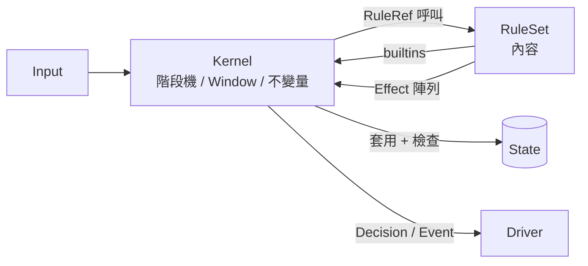

# 核心（Kernel）概念

> 2026-11-05。目標是可擴展性 L5：**核心不認識麻將**。核心是通用的牌類遊戲引擎，日麻、三麻、台灣 16 張都是寫在核心上的「內容」（RuleSet）。
> 開發順序：核心（最難）→ 日麻內容 → 變體。
> 相關文件：[flow-and-architecture-plan.md](flow-and-architecture-plan.md)（B 部分的日麻流程，在這裡降級為「日麻 RuleSet 的階段圖」）。

## 1. 核心與內容的界線

| 屬於核心 | 屬於內容（RuleSet） |
| :--- | :--- |
| 牌的實體、區域、座位、階段機、視窗、效果、亂數、日誌 | 有哪些牌、有哪些區域、幾個人、有哪些階段與動作 |
| 通用演算法（builtins）：多重集合分解、模式比對 | 和牌形、役、點數、流局條件 |
| 不變量檢查（牌數守恆、點數守恆） | 規則參數（赤牌數、起始點數） |

**判斷標準：** 一個概念如果只在某一種麻將出現，它就屬於內容。

## 2. 元件

### 2.1 Piece（實體牌）

```typescript
type PieceId = number;                     // 0..N-1，整局唯一
type PieceDef = { kind: number; attrs: Record<string, number | boolean> };
```

- `kind`：「同一種牌」的判斷依據（例如 0–33）。
- `attrs`：由內容定義，例如 `{ red: true }`、`{ flower: true, season: 2 }`。
- 「同一張」用 `PieceId` 判斷，「同一種」用 `kind` 判斷。目前程式只比 `type + index`，會遺失赤牌資訊，就是因為沒有區分這兩者。

### 2.2 Zone（區域）

```typescript
type ZoneDef = {
  id: string;                              // 'wall' | 'deadWall' | 'hand' | 'melds' | 'river' | 'flowers' | ...
  scope: 'shared' | 'perSeat';
  ordered: boolean;                        // 牌山、河是有序的；手牌不是
  visibility: 'public' | 'owner' | 'hidden';
};
```

每張牌在任何時刻都恰好位於一個區域。這是核心的第一個不變量。

### 2.3 Seat（座位）

- 人數 `N` 由 RuleSet 決定（3 或 4）。
- 座位固定；「誰是莊家」「場風」是內容的狀態，不是核心概念。

### 2.4 Phase graph（階段機，L4）

```typescript
type PhaseDef = {
  id: string;
  onEnter?: RuleRef;                       // 進入時執行，回傳 Effect[]
  decision?: DecisionDef;                  // 需要玩家回應時
  transitions: { to: string; when: RuleRef }[];   // 依序檢查，第一個成立的生效
};
```

階段機分層（match → hand → turn）由內容用巢狀的階段機表示，核心只負責「目前在哪個階段、下一個是哪個」。

### 2.5 Action 與 Decision（L3）

```typescript
type ActionDef = {
  id: string;                              // 'discard' | 'riichi' | 'pon' | 'chi' | 'tsumo' | 自訂
  params: ParamSchema;                     // 例如 { piece: PieceId }
  available: RuleRef;                      // 誰、在哪個階段、可以用哪些參數
  priority: number;                        // 在 Window 裡的優先序
  apply: RuleRef;                          // 回傳 Effect[]
};

type DecisionDef = {
  kind: 'single' | 'window';               // 單人決策，或多人同時回應
  who: RuleRef;                            // 哪些座位要回應
  timeoutMs: number;
  defaultAction: RuleRef;                  // 逾時時代送的動作
  resolve?: 'priority' | RuleRef;          // window 的結算方式（例如多家榮和）
};
```

### 2.6 Window（同時回應）

1. 核心送出 `Decision { seq, options, defaults }`。
2. 收集各座位的 `Input { seq, seat, actionId, params }`，逾時的座位由核心代送預設動作。
3. 依 `priority` 結算；同優先序時由 `resolve` 規則決定（日麻的頭ハネ、雙響）。
4. **提早結算**：已回覆的最高優先序不可能被蓋過時，不必等其他人。

### 2.7 Effect（核心唯一能改變狀態的方式）

| Effect | 說明 |
| :--- | :--- |
| `move(piece, fromZone, toZone, position?)` | 移動一張牌 |
| `reveal(piece, toSeats)` | 改變可見性 |
| `shuffle(zone)` | 用目前的 RNG 洗牌 |
| `transfer(fromSeat, toSeat, amount, reason)` | 轉移點數（只能轉移，不能憑空產生） |
| `setVar(scope, key, value)` | 內容的狀態變數（`scope`：`match` / `hand` / `seat`） |
| `emit(event)` | 送給客戶端的事件 |
| `goto(phase)` | 強制轉移階段（優先於 `transitions`） |

**不變量：** 每次套用 Effect 後檢查：牌數守恆（每張牌恰好在一個區域）、點數只透過 `transfer` 改變。違反時拒絕整批 Effect。

### 2.8 Builtins（由核心提供的高成本演算法）

內容（可能是 Starlark 或 QuickJS）不擅長的重運算，由核心用原生程式提供：

| Builtin | 說明 |
| :--- | :--- |
| `decompose(counts, patterns)` | 把多重集合分解成指定的組合（面子 + 雀頭、七對、十三么），回傳所有解 |
| `waits(counts, patterns)` | 加入每一種牌後能完成的種類 |
| `countKinds(zone, predicate)` | 計數 |

`patterns` 由內容提供，所以台灣 16 張（5 面子 + 1 雀頭）只是換一組 pattern，核心不用改。

### 2.9 RNG 與日誌

- RNG 由整場的 `seed` 產生，只能透過核心使用；內容不能讀時間或系統亂數。
- 日誌只記錄：`seed`、RuleSet 展開結果、所有 `Input`、使用者插件的回傳值。狀態都可以由此重建。

## 3. 驗收：三套規則只能改內容

| 需求 | 日麻（四人） | 三麻 | 台灣 16 張 |
| :--- | :--- | :--- | :--- |
| 牌 | 136 張，赤牌 `attrs.red` | 108 張（去掉 2–8 萬） | 144 張，含 8 張花牌 |
| 區域 | 牌山、王牌、手牌、副露、河 | 同左，另有拔北區 | 牌山、手牌、副露、河、花牌區 |
| 人數 | 4 | 3 | 4 |
| 手牌 | 13 | 13 | 16 |
| 和牌形 pattern | 4 面子 + 雀頭、七對、國士 | 同日麻 | 5 面子 + 雀頭 |
| 特有階段 | 立直宣告 | 拔北 | 補花（摸到花牌時立刻補牌） |
| Window 結算 | 頭ハネ或雙響 | 同日麻 | 截和或一炮多響 |
| 計分 | 符與番 | 符與番（無吃） | 台數 |

如果三套都能只改內容就完成，就達成 L5。**任何一套需要修改核心時，代表核心的抽象有問題，要先修核心。**

## 4. 執行模型



- 內容（RuleSet）只能讀取狀態與回傳 Effect，不能直接修改狀態。
- `RuleRef` 指向內容的一個函式。第一方內容可以是原生程式，使用者內容在沙箱中執行。
- 執行方式已決定：所有規則（包括日麻基本規則的預設模板庫）都是插件，用 TypeScript 撰寫，在 game-server 的 game Worker 內以 QuickJS 執行（每個 Worker 負責一批對局，每局一個 runtime，每一局重建 context）。詳見 [plugin-runtime-design.md](plugin-runtime-design.md)，數據見 `spikes/kernel-bench/RESULTS.md`。
