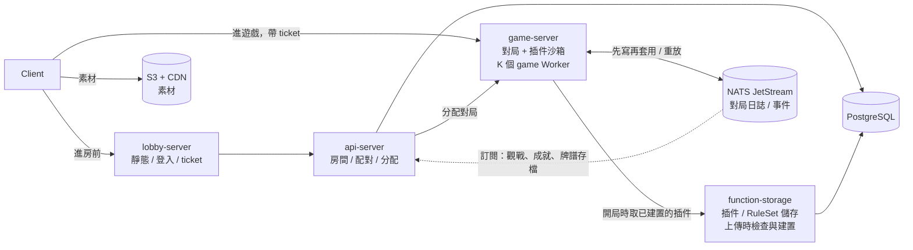
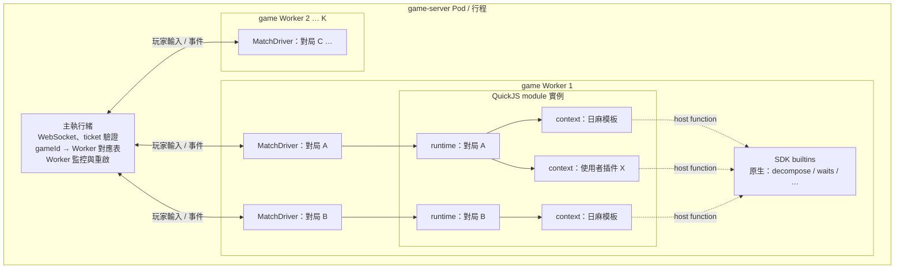
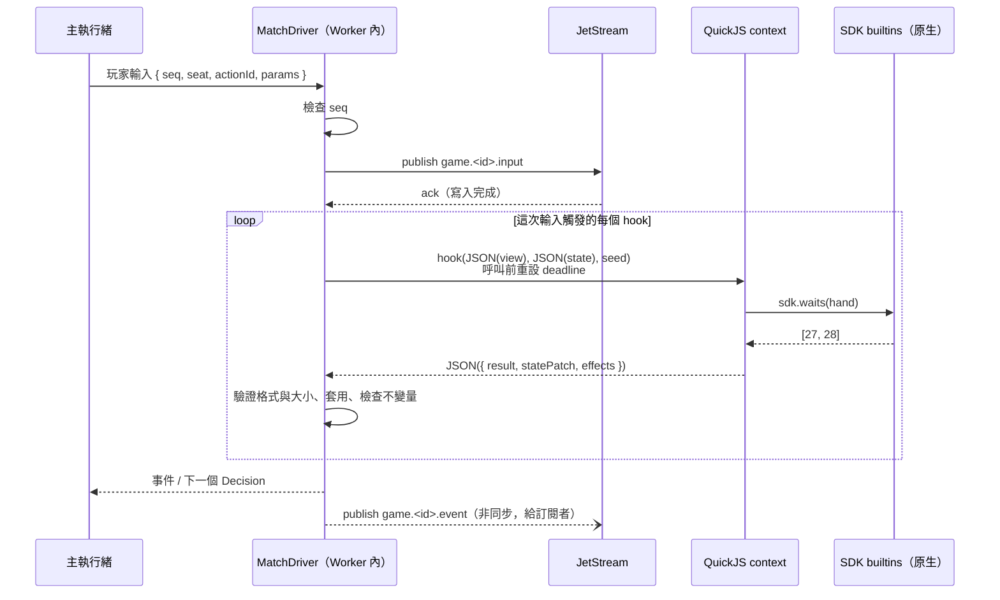
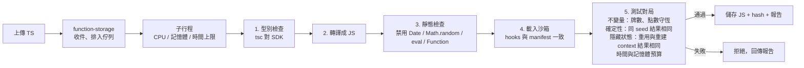

# 插件執行環境設計：game-server 內的 Worker 分片沙箱

> 2026-11-06 更新。決策依據：[spikes/kernel-bench/RESULTS.md](../../../spikes/kernel-bench/RESULTS.md)。
> 相關文件：[kernel-concept.md](kernel-concept.md)、[flow-and-architecture-plan.md](flow-and-architecture-plan.md)。

## 0. 簡易版

1. **所有規則都是插件。** 日麻基本規則以「預設模板庫」提供，和使用者插件格式相同。
2. **function-runner 拆掉，功能分給兩個服務：**
   - **執行**併入 **game-server**：K 個 game Worker，每個 Worker 負責一批對局，插件在 Worker 內的 QuickJS 執行。
   - **TS / JS 檢查與建置**併入 **function-storage**：上傳時型別檢查、轉譯、測試，通過才儲存。
3. **每一局（東一局、東二局…）重建一次 context。** 插件狀態放在主機端，每次呼叫傳入。
4. **對局日誌用 NATS JetStream，先寫再套用。** 輸入確認寫入後才套用，所以崩潰時不會遺失輸入；同一份日誌也提供觀戰、成就等功能訂閱。
5. **沙箱出錯不會拖垮 game-server。** 錯誤被限制在「單次呼叫 → 單局 → 單一 Worker」，見第 4 節。

最後剩下 **4 個服務**：



## 1. 決策摘要

| 項目 | 決策 |
| :--- | :--- |
| 服務 | lobby-server、api-server、game-server、function-storage（function-runner 移除） |
| 規則的形式 | 全部是插件；日麻基本規則是官方「預設模板庫」 |
| 撰寫語言 | TypeScript，對著有型別的 SDK（`@mahjong/plugin-sdk`）撰寫 |
| 並行方式 | game-server 內 K 個 game Worker，每個 Worker 負責一批對局（依 gameId 固定分配） |
| 執行方式 | Worker 內的 QuickJS；每局一個 runtime，每個插件一個 context |
| context 生命週期 | 每一局重建；同一局內重複使用 |
| 插件狀態 | 主機端的對局狀態，每次呼叫傳入、以 patch 傳回 |
| 上傳檢查與建置 | function-storage（在子行程中執行，見 5.2） |
| 對局日誌 | NATS JetStream；**先寫再套用**；每局結束存快照 |
| 官方模板庫 | 預設在沙箱執行；驗證過的版本可切換為 JIT 模式（同一份程式碼） |
| 何時重新評估 Go + Starlark | 單一 Pod 需要上萬局，或大量不等待的自我對弈時 |

## 2. 目前的問題（要被取代的部分）

| 問題 | 位置 |
| :--- | :--- |
| 每個 live module 獨占一個 Worker，pool 預設 2 個；第 3 個就失敗 | `function-runner/src/manager/liveModuleManager.ts` |
| `RunFunction` 每次呼叫都建新 context 並重新編譯（約 357 µs，重複使用只要 17 µs） | `function-runner/src/utils/vm.ts:72–75` |
| interrupt 計數器以 runtime 為單位累計、從不重設：累計 1000 次檢查後，之後的每次執行都會被中斷 | `function-runner/src/utils/vm.ts:28–31` |
| 插件狀態同時存在 game-server 與 runner 的 `__state__`，兩份會不一致 | `plugin-manager.ts`、`durableVM` |
| runner 插件被判定為可平行，`storagePatch` 被丟棄 | `game-server/src/plugins/plugin-manager.ts:513` |
| 每次 hook 呼叫都要一次跨行程 gRPC（毫秒級） | `plugin-manager.ts` `executeRunnerHook` |

## 3. game-server 內的執行環境

### 3.1 配置



| 層級 | 對應 | 理由 |
| :--- | :--- | :--- |
| 主執行緒 | 每個行程一個 | 只做連線、驗證、轉送、監控 Worker；**不執行任何插件程式碼** |
| game Worker | K 個，約等於核心數 | 多核心並行；一個 Worker 掛掉只影響它負責的對局 |
| QuickJS module 實例 | 每個 Worker 一個 | 同一個 module 的 runtime 共用一塊 WASM 記憶體 |
| runtime | 每局一個 | 記憶體上限與時限以局為單位 |
| context | 每個插件一個，每一局重建 | 插件之間隔離；局與局之間不殘留狀態 |

- **訊息粒度：** 主執行緒與 Worker 之間是「每個玩家輸入一則訊息」，一次輸入觸發的所有 hook 都在 Worker 內完成。spike 量測的 Worker 訊息往返約 0.1 ms（p99 約 2 ms）。
- **分配：** 開局時由主執行緒選定 Worker，整場固定不變。

### 3.2 context 生命週期：每一局重建

| 方式 | 成本 | 局與局之間的殘留狀態 | 快照與重放 |
| :--- | ---: | :--- | :--- |
| 每次呼叫重建 | 每次約 357 µs（比重複使用慢約 20 倍） | 無 | 任何時間點 |
| **每一局重建（採用）** | 每局每個插件一次，約 357 µs | 無 | 以局為單位：局開始的快照 + 該局的輸入 |
| 整場只建一次 | 最低 | 可能殘留 | 只能從整場開頭重放 |

- 插件狀態在主機端，context 只保存程式碼，所以狀態同步不依賴重建。
- 唯一的風險是插件把資料偷偷存在模組層級的變數。上傳時用「重複使用 context」與「每次重建 context」各跑一次測試對局，結果必須相同（見 5.1）。
- 成本：以 10 個插件計算，每局約 3.6 ms。

### 3.3 呼叫約定



- **輸入**：`view` 是唯讀狀態（只含 manifest 宣告要讀取的欄位）；`state` 是插件自己的狀態。
- **輸出**：`result`、`statePatch`、`effects`（只有 `Command` 類 hook 可以回傳）。
- **轉換**：JSON。量測顯示 JSON 約 4.5 µs、QuickJS 執行約 13 µs。

### 3.4 執行模式：沙箱與 JIT

| 模式 | 適用 | 每次規則呼叫 | 隔離 |
| :--- | :--- | ---: | :--- |
| 沙箱（預設） | 所有插件 | 約 17 µs | 記憶體上限、時限、無 I/O |
| JIT | 官方模板庫中標記為已驗證的版本 | 約 0.2 µs | 無沙箱，只能用在可信任的程式碼 |

兩種模式執行同一份建置後的 JS。官方模板庫的 CI 會在兩種模式下跑同一組測試對局，結果必須相同。

### 3.5 確定性

- context 建立時移除或覆寫 `Date`、`Math.random`；亂數由 `sdk.random()` 提供，種子由「整場 seed + Decision.seq + pluginId」推導。
- 不注入任何 I/O；唯一的 host function 是 SDK builtins，它們都是純函式。

## 4. 故障隔離：沙箱出錯時 game-server 不會倒

| 層級 | 什麼會出錯 | 擋在哪裡 | 影響範圍 | 復原方式 |
| :--- | :--- | :--- | :--- | :--- |
| 0. 上傳 | 型別錯誤、禁用 API、隱藏狀態、不守恆、太慢 | function-storage 的檢查管線 | 插件不會被儲存 | 回傳報告 |
| 1. 單次呼叫 | 例外、逾時（5 ms）、回傳格式錯誤、超過大小上限 | QuickJS interrupt、主機端驗證 | 這次呼叫視為「無結果」 | 記錄日誌；連續失敗 3 次則該局停用此插件 |
| 2. 單局 | 記憶體超過上限（16 MB） | `runtime.setMemoryLimit` | 只有這一局的 runtime | 重建該局的 runtime，從局開始的快照重放 |
| 3. 單一 Worker | WASM trap、Worker 崩潰、無回應 | 主執行緒的心跳監控 | 該 Worker 負責的對局 | 重啟 Worker，各對局從快照 + JetStream 日誌重放 |
| 4. 整個 Pod | 行程崩潰（例如執行環境的 bug） | Kubernetes | 該 Pod 的所有對局 | 重新分配到其他 Pod，從 JetStream 重放 |

- **主執行緒不執行任何插件程式碼**，所以連線不會因為沙箱出錯而中斷（第 3 層以下）。
- **先寫再套用**讓第 2–4 層的復原不會遺失輸入：每個已套用的輸入一定已經在 JetStream 裡。
- RuleSet 標記為「必要」的插件被停用時，中止該局、退回分數並記錄原因。
- **如果仍然不放心：** 可以把 game Worker 改成獨立的子行程（`Bun.spawn`），隔離程度更高，代價是行程間通訊的成本（未量測）。因為邊界本來就是「每個輸入一則訊息」，這個切換不影響其他設計。

### 4.1 資源限制

| 限制 | 建議預設值 | 機制 |
| :--- | :--- | :--- |
| 每局 runtime 記憶體 | 16 MB | `runtime.setMemoryLimit` |
| 堆疊 | 1 MB | `runtime.setMaxStackSize` |
| 每次 hook 呼叫時限 | 5 ms（量測值 17 µs） | 每次呼叫前重設 `shouldInterruptAfterDeadline` |
| 插件狀態、回傳值大小 | 各 64 KB | 主機端檢查 |
| Worker 心跳逾時 | 1 秒 | 主執行緒監控 |

## 5. 撰寫與上傳（function-storage）

### 5.1 檢查與建置管線



- 官方模板庫也走同一條管線。
- game-server 只載入通過檢查的版本（依 hash）。
- 這也是 RuleSet 展開時「衝突檢查」的資料來源（manifest 宣告的 hooks、provides、reads）。

### 5.2 function-storage 的隔離

檢查管線會執行不受信任的程式碼（第 4、5 步），所以：

- **每個檢查工作在獨立的子行程中執行**，有 CPU、記憶體與總時間上限；子行程崩潰不影響 function-storage 本身的 API 與資料庫連線。
- **工作排入佇列，限制同時執行數**（例如 1–2 個），大量上傳不會拖慢插件的讀取。
- 測試對局使用的核心與 SDK，和 game-server 是**同一個套件**，避免「檢查通過但執行時行為不同」。

### 5.3 SDK

```typescript
import { definePlugin, sdk, type DecisionContext } from '@mahjong/plugin-sdk';

export default definePlugin({
  manifest: { name: 'furiten', version: 1 },
  reads: ['hand', 'discards'],             // 這個插件要讀的狀態欄位（決定 view 的內容）
  initialState: { furiten: {} as Record<string, boolean> },

  hooks: {
    onValidateAction(ctx: DecisionContext, state) {
      if (ctx.action.id !== 'ron') return {};
      const waits = sdk.waits(ctx.view.hand[ctx.seat]);      // 原生 builtin
      const furiten = waits.some((k) => ctx.view.discards[ctx.seat].includes(k));
      return { result: { reject: furiten } };
    },
  },
});
```

- **型別**：hook 名稱與 payload、`view` 的形狀、Effect 的建構函式、Action 的定義。
- **builtins**：`decompose`、`waits`、`shanten`、`countKinds` 等，原生實作，以 host function 注入 QuickJS。

## 6. 對局日誌與事件（NATS JetStream）

| 資料 | 位置 | 用途 |
| :--- | :--- | :--- |
| 玩家輸入 | stream `GAME_LOG`，subject `game.<gameId>.input` | 重放、崩潰復原（**先寫再套用**） |
| 每局開始的快照 | KV bucket `game_snapshots`，key `<gameId>` | 重放的起點 |
| 對局事件 | subject `game.<gameId>.event` | 觀戰、成就、牌譜存檔等訂閱者 |
| 對局結束後的紀錄 | api-server 訂閱後寫入 PostgreSQL | 歷史查詢 |

**單節點可以嗎？** 可以。JetStream 可以只跑一個節點（stream 副本數 R1），適合開發與小規模；代價是沒有高可用，該節點的磁碟遺失時資料就遺失。正式環境需要高可用時，改成 3 節點、R3。

**先寫再套用的成本：** 每個輸入多一次 publish + ack。這個延遲尚未量測；以真人或模擬真人的節奏，毫秒級的延遲不影響體驗，但要量測確認。

**復原流程：** 取得該局的快照 → 從快照記錄的 stream 序號開始讀取輸入 → 依序套用。因為每一局重建 context 且插件是確定性的，結果會和崩潰前相同。

## 7. 容量估算

依 spike 的量測值（單執行緒；規則與 spike 同等大小）：

| 項目 | 300 局 | 3,000 局 |
| :--- | ---: | ---: |
| 決策數（估：每局每秒 0.6 個） | 180 / 秒 | 1,800 / 秒 |
| CPU（全部在沙箱：15k 決策/秒/核心） | 約 1 個核心的 1.2% | 約 1 個核心的 12% |
| 沙箱記憶體（每局 0.14–0.28 MB） | 約 40–85 MB | 約 0.4–0.8 GB |
| JetStream 寫入（每個輸入一次） | 約 180 / 秒 | 約 1,800 / 秒 |
| 需要的 game Worker | 1 個就夠；建議 2 個以上做故障隔離 | 2–4 個 |

## 8. 修改方向（依順序）

| 步驟 | 內容 | 完成的判斷標準 |
| :--- | :--- | :--- |
| 1 | **SandboxHost**（game-server）：每局一個 runtime、每插件一個 context、每局重建、時限與大小檢查 | spike 的規則結果相同；300 局的記憶體與 CPU 在估算範圍內 |
| 2 | **game Worker 分片**：主執行緒只做連線、轉送、監控；對局整個搬進 Worker | 殺掉一個 Worker，其他 Worker 的對局不受影響 |
| 3 | **JetStream 日誌**：先寫再套用、每局快照、重放 | 殺掉 Worker 後，對局從日誌還原且狀態相同；量測 publish + ack 延遲 |
| 4 | **SDK 與 builtins**：先做 `waits`、`decompose` | 量測 builtin 跨邊界的成本 |
| 5 | **PluginManager 改寫**：移除遠端呼叫、live module、啟發式排序；狀態改由主機管理 | 所有插件走同一條路徑 |
| 6 | **日麻模板庫**：把基本規則寫成插件 | 用預設模板能打完一局 |
| 7 | **function-storage 檢查管線**：子行程、佇列、5 個步驟 | 能拒絕有隱藏狀態的插件；檢查工作崩潰不影響 API |
| 8 | **移除 function-runner**：服務、Helm 設定、`runner.proto`、CI 的建置項目 | 4 個服務可以完整跑一局 |

## 9. 未解決的問題

- builtin 呼叫跨越 QuickJS 邊界的成本尚未量測。
- JetStream publish + ack 的延遲尚未量測；NATS 的 JS 客戶端在 Bun 上的相容性尚未確認。
- 每個 Worker 要承載幾局、要幾個 Worker：需要用實際的模板庫量測後決定。
- QuickJS 的 bytecode 快取能否降低每局重建 context 的成本：尚未評估。
